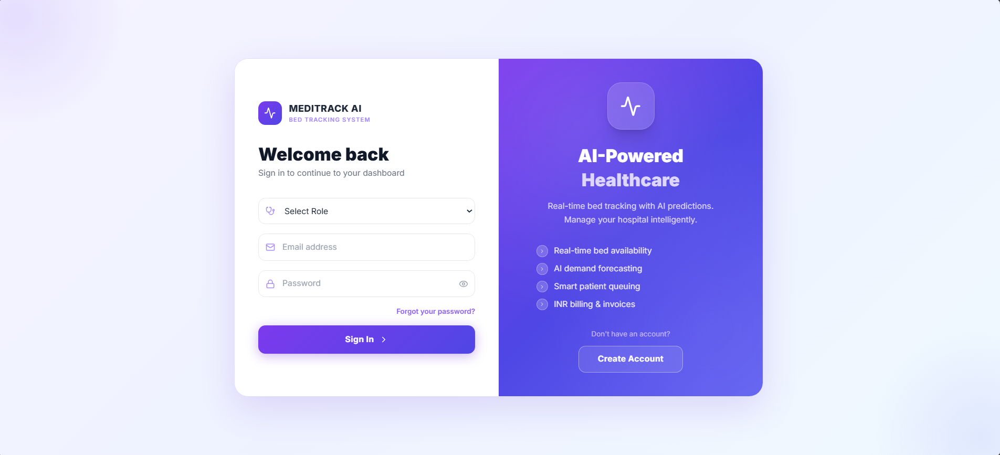
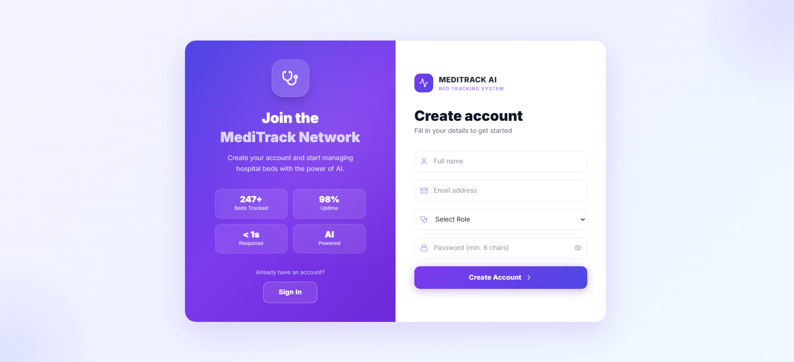
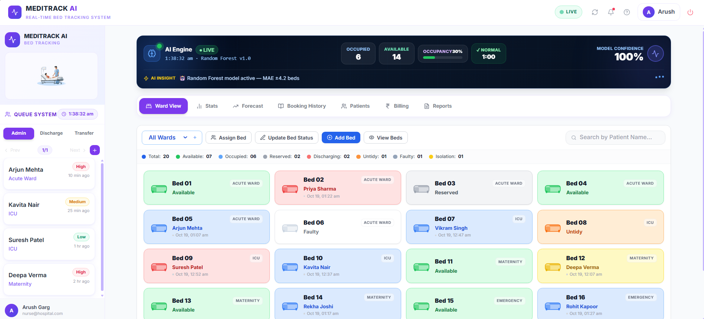
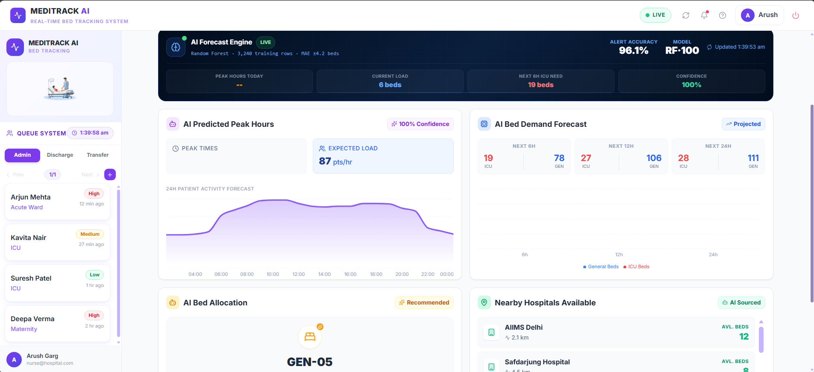
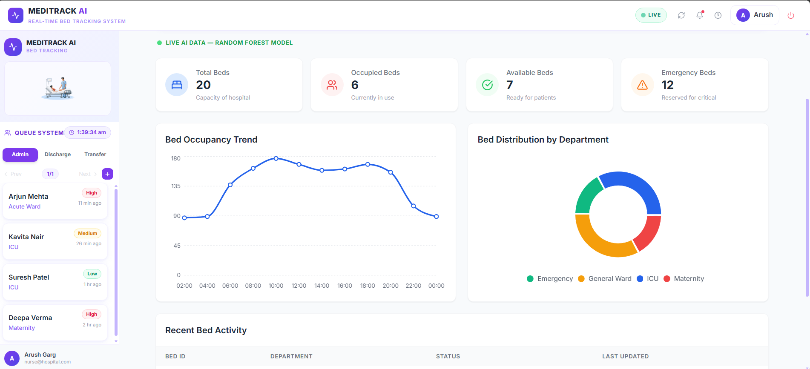
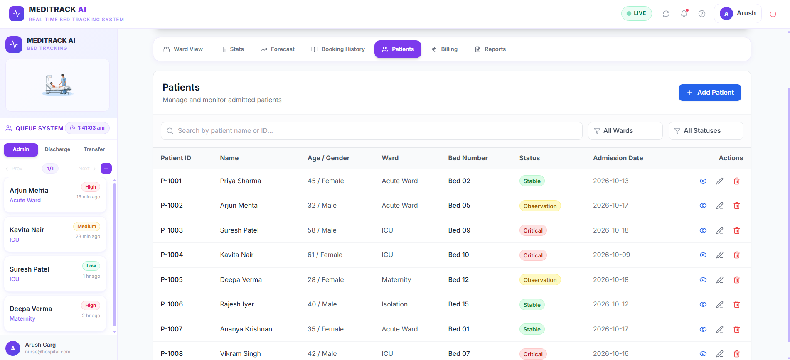
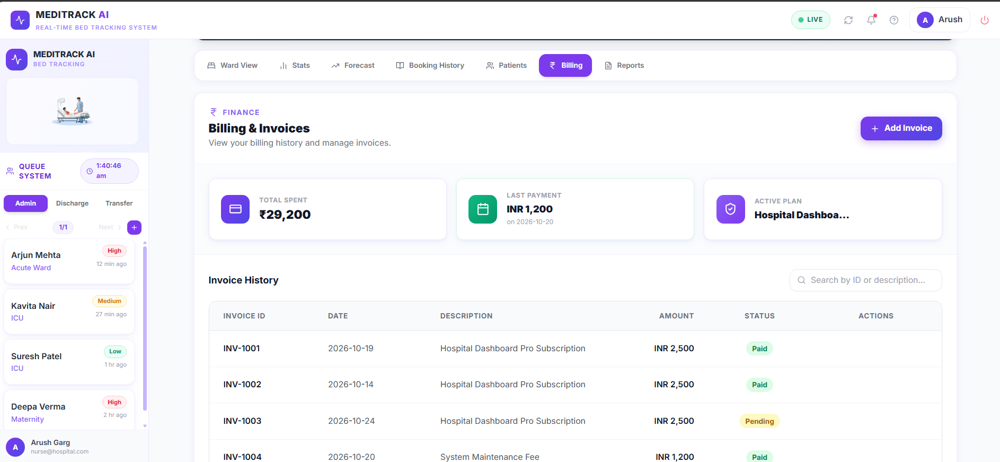

<p align="center">
  
</p>

<h1 align="center">🏥 AI-Powered Real-Time Bed Tracking System</h1>

<p align="center">
  <b>A full-stack hospital bed management dashboard with a machine-learning backend that forecasts occupancy, flags surges, and recommends beds.</b>
</p>

<p align="center">
  
  
  
  
  
</p>

---

## 📋 Table of Contents

- [About](#-about)
- [Problem Statement](#-problem-statement)
- [Features](#-features)
- [How the AI Works](#-how-the-ai-works)
- [Architecture](#-architecture)
- [Screenshots](#-screenshots)
- [Tech Stack](#-tech-stack)
- [Project Structure](#-project-structure)
- [Getting Started](#-getting-started)
- [Usage](#-usage)
- [Roadmap](#-roadmap)
- [Contributing](#-contributing)
- [License](#-license)

---

## 🎯 About

The **AI-Powered Real-Time Bed Tracking System** gives hospital administrators, nurses, and billing staff one dashboard to monitor bed status across wards, manage patients and invoices, and see AI-driven predictions of upcoming demand.

The React frontend talks to a **FastAPI** service running two **scikit-learn Random Forest** models. If the API is offline, the dashboard falls back gracefully to mock AI data so the UI never breaks.

---

## ❗ Problem Statement

| Problem | Impact |
|---|---|
| **Manual bed tracking** | Staff waste hours calling wards to check availability |
| **No real-time visibility** | No at-a-glance view of free, occupied, or faulty beds |
| **Long wait times** | Patients queue while beds sit empty elsewhere |
| **Inefficient discharge flow** | Discharged beds stay blocked |
| **No priority-based allocation** | Critical patients wait like non-urgent ones |
| **Reactive, not proactive** | Surges and demand can't be anticipated |

This system addresses these with a live color-coded dashboard, a priority queue, full CRUD workflows, and **ML-based occupancy forecasting and alerts**.

---

## ✨ Features

### 🛏️ Ward View
- Live grid of beds grouped by ward (Acute Ward, ICU, Maternity, Isolation)
- Each card shows status, patient name, and timestamp
- Actions: **Assign**, **Update Status**, **Discharge**, **Transfer**, **Delete**
- **Add Bed** with number, ward, and initial status
- Discharged or transferred patients are automatically added to the waiting queue
- Real-time search by bed number, patient name, or status, plus ward filtering

| Status | Color | Meaning |
|---|---|---|
| 🟢 Available | Green | Ready for a new patient |
| 🔵 Occupied | Blue | Currently has a patient |
| ⚪ Reserved | Gray | Reserved for an incoming patient |
| 🔴 Discharging | Red | Patient being discharged |
| 🟠 Untidy | Orange | Needs cleaning |
| 🩶 Faulty | Slate | Under maintenance |
| 🟡 Isolation | Yellow | Isolation protocol active |

### 🤖 AI Forecast
Four panels powered by the FastAPI backend:

| Panel | What it shows |
|---|---|
| **Peak Hour Prediction** | Hours predicted as peak (>30% surge probability) with an activity chart |
| **Bed Demand Forecast** | Expected ICU + General bed demand for the next 6h / 12h / 24h |
| **Bed Recommendation** | A specific bed type (ICU or General) based on the current alert level |
| **Nearby Hospitals** | Neighboring facilities and their available beds, for overflow planning |

Plus an **Emergency Surge Alert** and an always-visible **Live AI Banner** (live clock, model status, occupancy %, peak-hour flag, model confidence, and a rotating insight ticker).

### 📊 Stats Dashboard
Live totals for every bed status, derived directly from the bed state.

### 👥 Patient Queue
- Tabs: **Admin**, **Discharge**, **Transfer**
- Priority levels: High, Medium, Low
- Paginated (4 per page); assign directly from the queue to an available bed

### 🧑‍⚕️ Patients
- Full CRUD with age, blood group, and clinical notes
- Search by name or ID; filter by ward and status (Stable / Observation / Critical)
- Table view on desktop, cards on mobile

### 💳 Billing & Invoices
- Create / view / edit / delete invoices with delete confirmation
- Summary cards: Total Spent, Last Payment, Active Plan
- Search by invoice ID or description

### 📋 Booking History
Historical log of bookings and patient assignments.

### 🔐 Authentication
- Login and registration with validation
- Role-based access (Admin, Nurse, Billing, Viewer)
- Persistent sessions and protected routes

---

## 🧠 How the AI Works

### Models (`backend/train.py`)
Two Random Forest models are trained on **3,240 rows of synthetic hospital data**:

| Model | Type | Task |
|---|---|---|
| **Occupancy** | `RandomForestRegressor` (100 trees, depth 12) | Predicts occupied beds for a given hour |
| **Alert** | `RandomForestClassifier` (100 trees, depth 10, class-balanced) | Predicts whether occupancy hits **CRITICAL** (≥78% full) |

**Input features:** `hour` (0–23), `day` (0–6), `is_weekend` (0/1), `is_festival` (0/1)

**Simulated patterns:** morning peak (~10 AM), evening peak (~6 PM), night lull (after 10 PM / before 6 AM), weekday vs. weekend differences, and a +12% festival-day surge.

### API (`backend/main.py`)

| Endpoint | Returns |
|---|---|
| `GET /predict` | Current hour: occupied, available, alert (`NORMAL`/`CRITICAL`), alert probability |
| `GET /forecast` | All 24 hours of a day: occupied, available, alert probability |
| `GET /health` | Service health check |

Models are saved as `.joblib` files and **auto-trained on first run** if missing.

### Frontend integration (`Dashboard.jsx`)
On load, and every 5 minutes, the dashboard:
1. Calls `/forecast` for the 24-hour occupancy curve
2. Calls `/predict` for the current hour's status
3. Derives peak hours (alert probability > 30%), the ICU/General split (20% / 80% heuristic), and the bed recommendation
4. Falls back to mock AI data if the API is unreachable

---

## 🏗️ Architecture

```
User Browser (React + Vite)
    │
    ├── AuthContext ─── login / register / sessions
    ├── BedContext  ─── live bed + queue state, CRUD
    │
    └── Dashboard.jsx
          ├── GET /forecast ──┐
          ├── GET /predict  ──┼──► FastAPI (port 8000)
          │                   │        └── Random Forest models (.joblib)
          │                   │              trained on synthetic data
          └── Renders: Ward View, Stats, Forecast, Patients, Billing, History
```

---

## 📸 Screenshots

### Login Page


### Registration Page


### Dashboard — Ward View


### Dashboard — AI Forecast


### Dashboard — Stats


### Dashboard — Patients


### Dashboard — Billing


---

## 🛠️ Tech Stack

| Layer | Technology |
|---|---|
| **Frontend** | React 19, Vite 7, TailwindCSS 3 |
| **Routing** | React Router 7 (lazy-loaded, protected routes) |
| **State** | React Context API |
| **Icons** | Lucide React |
| **Backend API** | FastAPI (Python) |
| **AI / ML** | scikit-learn (Random Forest), joblib |
| **Code Quality** | ESLint 9 |

---

## 📂 Project Structure

```
ai-bed-tracking-system/
├── backend/                     # FastAPI + scikit-learn API
│   ├── main.py                  # /predict, /forecast, /health
│   ├── train.py                 # Trains models on 3,240 synthetic rows
│   ├── config.py
│   ├── requirements.txt
│   └── models/                  # Generated .joblib artifacts (gitignored)
├── public/
├── src/
│   ├── assets/
│   ├── components/
│   │   ├── ai/                  # AILiveBanner, BedDemandForecast, BedRecommendation,
│   │   │                        # EmergencySurgeAlert, NearbyHospitals, PeakHourPrediction
│   │   ├── beds/                # AddBedModal, AssignBedModal, BedCard, BedGrid, UpdateStatusModal
│   │   ├── layout/              # Layout, Sidebar, Topbar
│   │   ├── queue/               # QueueList
│   │   └── ui/                  # Badge, Button, Input, Modal
│   ├── context/                 # AuthContext, BedContext
│   ├── data/                    # mockData.js (seed data + AI fallback)
│   ├── pages/                   # Dashboard, Login, Register
│   ├── routes/                  # AppRoutes, ProtectedRoute
│   ├── App.jsx
│   ├── index.css
│   └── main.jsx
├── index.html
├── package.json
├── tailwind.config.js
├── postcss.config.js
├── vite.config.js
└── eslint.config.js
```

---

## 🚀 Getting Started

### Prerequisites
- **Node.js** ≥ 18
- **npm** ≥ 9 (or yarn / pnpm)
- **Python** ≥ 3.10

### Installation

1. **Clone the repository**
   ```bash
   git clone https://github.com/your-username/ai-bed-tracking-system.git
   cd ai-bed-tracking-system
   ```

2. **Install frontend dependencies**
   ```bash
   npm install
   ```

3. **Set up the AI backend**
   ```bash
   cd backend
   python -m venv .venv
   # Windows:
   .venv\Scripts\activate
   # macOS / Linux:
   # source .venv/bin/activate
   pip install -r requirements.txt
   python train.py
   cd ..
   ```
   If `backend/models/` is empty, models are trained automatically on first API start.

4. **Start both servers** (two terminals)

   ```bash
   npm run api    # Terminal 1 — FastAPI on port 8000
   ```
   ```bash
   npm run dev    # Terminal 2 — React on port 5173
   ```

5. **Open** http://localhost:5173 and check the **Forecast** or **Stats** tab for live model output.
   API docs: http://127.0.0.1:8000/docs

### Production Build
```bash
npm run build
npm run preview
```

---

## 💡 Usage

### Login (Mock Auth)
Sign in with any email and password. The role is inferred from the email:

| Email contains | Role |
|---|---|
| `nurse` | Nurse |
| `billing` | Billing |
| `viewer` | Viewer |
| anything else | Admin |

**Example:** `admin@hospital.com` / `password123`

### Quick Actions
- **Add a bed** → `+ Add Bed` in the toolbar
- **Assign a patient** → click a green (Available) bed
- **Update status / discharge / transfer** → click any other bed
- **Filter by ward** → ward dropdown in the toolbar
- **Search** → search bar in the status legend

---

## 🗺️ Roadmap

- [x] Authentication and protected routes
- [x] Ward view with full bed CRUD
- [x] Patient queue (Admin / Discharge / Transfer)
- [x] Patients directory (full CRUD)
- [x] Billing and invoices
- [x] Booking history
- [x] Stats dashboard
- [x] FastAPI backend with Random Forest occupancy and alert models
- [x] AI forecast, peak-hour prediction, surge alerts, bed recommendations
- [x] Live AI banner with graceful offline fallback
- [ ] Train models on real hospital data
- [ ] Persistent database for beds, patients, and invoices
- [ ] Server-side authentication
- [ ] Reports module

---
q
1. Fork the repository
2. Create a feature branch (`git checkout -b feature/amazing-feature`)
3. Commit your changes (`git commit -m 'Add amazing feature'`)
4. Push the branch (`git push origin feature/amazing-feature`)
5. Open a Pull Request

> Work in feature branches; merge to `main` only after review.

---

## 📄 License

Available under the [MIT License](LICENSE).

---